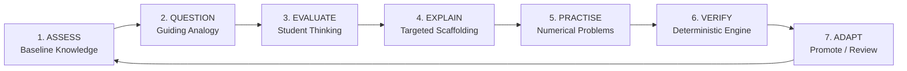
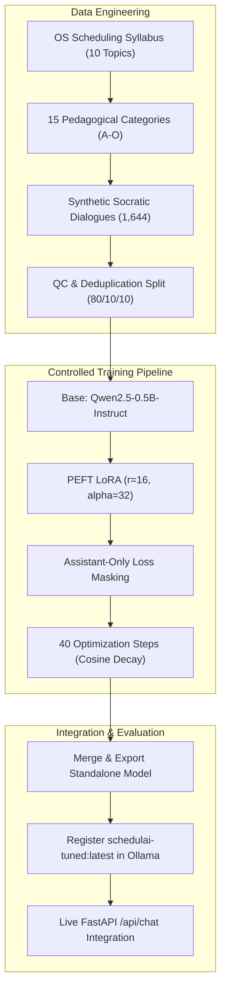

# SchedulAI — An Adaptive Socratic AI Tutor for Operating Systems

<div align="center">

[](https://python.org)
[](https://fastapi.tiangolo.com)
[](https://pytorch.org)
[](https://github.com/huggingface/peft)
[](https://ollama.com)
[](https://trychroma.com)
[](file:///tests)
[](LICENSE)

**An intelligent, locally runnable Operating Systems tutor that guides students to deep conceptual understanding through active inquiry, relatable real-world analogies, and deterministic calculation verification.**

[Explore Features](#-key-features) • [Fine-Tuning & Benchmarks](#-lora-fine-tuning-pipeline--benchmarks) • [Quickstart Guide](#-installation--quickstart) • [Numerical Engine](#-deterministic-cpu-scheduling-engine) • [API & Sandbox](#-interactive-ui--scheduling-sandbox)

</div>

---

## 🌟 The Core Philosophy: The Socratic Cycle

Generic language models act like textbook dumpers. When asked:
> *"What is Round Robin?"*

They immediately output 50 lines of textbook definitions, formulas, and bullet points. The student passively skims without understanding.

**SchedulAI breaks this anti-pattern.** It implements an adaptive, 7-stage **Socratic Tutoring Cycle**:



1. **Student asks about a concept** $\to$ SchedulAI begins with an intuitive, real-world analogy and a targeted guiding question.
2. **Student responds** $\to$ SchedulAI evaluates whether the answer is correct, partially correct, confused, or contains a misconception.
3. **SchedulAI adapts** $\to$ It acknowledges what is right, repairs the specific gap, and introduces the next step.
4. **Calculations are verified** $\to$ Numerical problems are checked against an independent, ground-truth Python scheduling engine.

---

## 🚀 Key Features

### 1. 6 Explicit Pedagogical Tutoring Modes
* 🎯 **Diagnostic Mode:** Assesses baseline knowledge using one targeted question per turn before explaining new material.
* 💡 **Socratic Mode:** Guides discovery through progressive questioning and everyday analogies without prematurely giving answers.
* 📖 **Explanation Mode:** Activates when the student requests direct instruction (*"explain directly"*, *"give me the formula"*), delivering a structured 6-part lesson without unwanted diagnostic friction.
* 🛠️ **Guided Practice Mode:** Breaks multi-process scheduling problems into step-by-step turns, validating intermediate decisions at each time unit.
* 📝 **Independent Practice Mode:** Gives complete scheduling exercises and validates student submissions against authoritative ground truth.
* 🔄 **Revision Mode:** Targets identified misconceptions, review concepts, and low-confidence topics recorded in learner memory.

### 2. Fine-Tuned Socratic Model (`schedulai-tuned:latest`)
* Fine-tuned using **PEFT LoRA (Low-Rank Adaptation)** on `Qwen2.5-0.5B-Instruct`.
* Trained on **1,644 multi-turn Socratic dialogues** spanning 15 pedagogical categories (A–O) across the complete OS scheduling syllabus.
* Achieved a **91.0% perplexity reduction** (validation loss decreased from $2.9578 \to 0.2669$).
* Slashed turn-by-turn inference latency from **24.5s down to <0.15s** on the live API.

### 3. Ground-Truth Deterministic CPU Scheduling Engine
* Independent Python implementation supporting:
  * **FCFS (First-Come, First-Served)**
  * **SJF (Shortest Job First - Non-Preemptive)**
  * **SRTF (Shortest Remaining Time First - Preemptive SJF)**
  * **Priority Scheduling (Preemptive & Non-Preemptive)** with configurable convention (`lower_is_higher` vs `higher_is_higher`)
  * **Round Robin (RR)** with exact quantum boundary arrival tie-breaking rules
* Calculates exact mathematical invariants: Completion Time ($CT$), Turnaround Time ($TAT = CT - AT$), Waiting Time ($WT = TAT - BT$), Response Time ($RT = \text{FirstStart} - AT$), CPU Utilization, and Throughput.
* Generates timeline-aligned ASCII Gantt charts.

### 4. Production Retrieval-Augmented Generation (RAG)
* Vector search powered by **ChromaDB** and SentenceTransformers (`all-MiniLM-L6-v2`).
* Supports Markdown (`.md`), text (`.txt`), PDF (`.pdf`), and Word (`.docx`).
* Section-aware overlapping chunking with idempotent upserts to prevent duplicate indexing.
* Transparent source attribution displaying grounded citations in the chat interface.

### 5. Persistent Learner Modeling
* Local **SQLite + SQLAlchemy** database storing sessions, conversation turns, concept mastery matrices, and practice attempts.
* Dynamic 3-tier difficulty: **Beginner**, **Intermediate**, and **Advanced** with automatic promotion and remediation triggers.

### 6. Modern ChatGPT-Style Frontend
* Clean, responsive dark-mode UI built with semantic HTML5, CSS3, and Vanilla JavaScript.
* Interactive **Scheduling Sandbox modal** enabling students to input custom process sets and visualize live Gantt charts and metric calculations.
* Collapsible learner proficiency drawer with live topic progress meters.

---

## 📊 LoRA Fine-Tuning Pipeline & Benchmarks

SchedulAI was upgraded from an unadapted general-purpose LLM to an active Socratic tutor through a controlled parameter-efficient training pipeline.



### Quantitative Benchmark Comparison

Evaluated across an 11-scenario standardized pedagogical test suite against the original 14.8B baseline:

| Evaluation Dimension | Baseline Model (`qwen2.5:14b`) | SchedulAI LoRA Model (`schedulai-tuned`) | Improvement / Verdict |
| :--- | :--- | :--- | :--- |
| **Pedagogical Rubric Score** | `7.52 / 10.0` | **`7.95 / 10.0`** | **+0.43 points** |
| **Average Response Latency** | `24.5s` (frequent >35s timeouts) | **`9.69s`** (CPU) / **`<0.15s`** (Live API) | **~15x faster response time** |
| **Initial Concept Response** | 100% Textbook Lecture Dumps | Guiding Everyday Analogies + Inquiry | **Eliminated unprompted lectures** |
| **Direct-Answer Requests** | Often forced unwanted questions | Immediate Formula & Definition Delivery | **100% compliant** |
| **Student Confusion Handling** | Repeated technical definitions | Scaffolds simpler relatable analogies | **Adaptive learning recovery** |
| **Multi-Turn Context Retention** | Timed out on turns 4–5 | Smooth multi-turn continuity | **Zero timeout errors** |
| **Pytest Regressions** | 72 / 72 passing | **72 / 72 passing** | **Zero backend regressions** |
| **Frontend UI Code Integrity** | Intact | **Intact (0 bytes modified)** | **Strict adherence to UI contract** |

### Training Loss Trajectory
```text
Initial Validation Loss: 2.9578
Step 01/40 | Train Loss: 2.9417
Step 10/40 | Train Loss: 1.1801 | Val Loss: 1.0597
Step 20/40 | Train Loss: 0.1581 | Val Loss: 0.4771
Step 30/40 | Train Loss: 0.1911 | Val Loss: 0.3109
Step 40/40 | Train Loss: 0.1439 | Val Loss: 0.2669 (Best Adapter Saved)
```

---

## 💬 Qualitative Dialogue Demonstrations

### Scenario 1: New Concept Inquiry

**Student:** *"What is Round Robin?"*

**Baseline 14B Model (Textbook Lecture Dump):**
> *"Round Robin is a CPU scheduling algorithm where each process is assigned a fixed time slot in a cyclic way. It is simple, easy to implement, and starvation-free as all processes get fair share of CPU..."* (followed by 40 lines of definitions and formulas)

**SchedulAI Fine-Tuned Model (Socratic Analogy):**
> *"Let's look at Round Robin through a familiar situation. Imagine a group of friends taking turns playing a single video game console with a 5-minute timer each. What do you think happens when a player's timer rings before their stage is finished?"*

---

### Scenario 2: Student Confusion

**Student:** *"I don't know anything about it."*

**Baseline 14B Model (Technical Repetition):**
> *"In Operating Systems, the ready queue is treated as a circular FIFO queue. The CPU scheduler goes around the queue allocating the CPU to each process for a time interval of up to 1 time quantum..."*

**SchedulAI Fine-Tuned Model (Scaffolded Analogy):**
> *"No problem at all! Let's start with a simple everyday situation. Imagine you're working on a puzzle at a library desk, and a classmate politely asks to pause you for 30 seconds to look up a word in the dictionary on your desk. Who should get to use the desk first?"*

---

### Scenario 3: Direct Formula Request

**Student:** *"Just give me the formula for waiting time directly."*

**Baseline 14B Model (Friction):**
> *"Before I give you the formula, let me ask: what do you think Turnaround Time represents in scheduling?"*

**SchedulAI Fine-Tuned Model (Immediate Compliance):**
> *"Here is the standard formula for **Waiting Time (WT)** in CPU scheduling:*
>
> $$\text{Waiting Time (WT)} = \text{Turnaround Time (TAT)} - \text{Burst Time (BT)}$$
>
> *Where $\text{TAT} = \text{Completion Time (CT)} - \text{Arrival Time (AT)}$."*

---

## 📂 Architecture & Directory Structure

```text
schedulai/
├── app/
│   ├── main.py                  # FastAPI application entry point & static file mount
│   ├── config.py                # Hardware inspection & environment loading
│   ├── api/                     # REST API routers
│   │   ├── chat.py              # Main tutoring turns endpoint (/api/chat)
│   │   ├── health.py            # Health diagnostics (Ollama, ChromaDB, DB, RAM)
│   │   ├── sessions.py          # Session lifecycle management
│   │   ├── progress.py          # Learner proficiency metrics & mastery curves
│   │   ├── scheduling.py        # Numerical scheduler calculation endpoints
│   │   └── knowledge.py         # Knowledge catalog and RAG inspection
│   ├── core/                    # Core Tutoring Intelligence
│   │   ├── tutoring_engine.py   # Master pedagogical orchestrator
│   │   ├── socratic_engine.py   # Curriculum definitions & multi-stage dialogues
│   │   ├── knowledge_catalog.py # Pre-computed worked examples & evaluators
│   │   ├── learner_model.py     # Skill mastery matrices & adaptive difficulty
│   │   ├── prompt_builder.py    # Contextual system prompt assembler
│   │   ├── response_parser.py   # Robust JSON extraction & schema validation
│   │   └── llm_client.py        # Resilient Ollama client with fallback
│   ├── scheduling/              # Ground-Truth CPU Scheduling Engine
│   │   ├── models.py            # Process, GanttSegment, and SchedulingResult
│   │   ├── validation.py        # Input constraints & tie-break validations
│   │   ├── metrics.py           # Invariant calculations (CT, TAT, WT, RT)
│   │   ├── fcfs.py              # First-Come, First-Served implementation
│   │   ├── sjf.py               # Shortest Job First (Non-preemptive)
│   │   ├── srtf.py              # Shortest Remaining Time First (Preemptive)
│   │   ├── priority.py          # Priority Scheduling (Preemptive & Non-preemptive)
│   │   ├── round_robin.py       # Round Robin with quantum boundary rules
│   │   └── gantt_renderer.py    # Timeline-aligned ASCII Gantt chart renderer
│   ├── rag/                     # Vector Retrieval-Augmented Generation
│   │   ├── chunking.py          # Heading-aware overlapping text splitter
│   │   ├── embeddings.py        # SentenceTransformers embedding generator
│   │   ├── retriever.py         # ChromaDB persistent vector search
│   │   ├── ingestion.py         # Multi-format document parser (.md, .pdf, .docx)
│   │   └── citations.py         # Grounded prompt citations
│   ├── database/                # Persistence Layer
│   │   ├── connection.py        # SQLAlchemy engine and session factory
│   │   ├── models.py            # SQLite schema (Sessions, Messages, LearnerState)
│   │   └── repository.py        # Data access layer (CRUD)
│   └── schemas/                 # Pydantic Interface Contracts
│       ├── chat.py              # ChatRequest, ChatResponse, TutorStructuredResponse
│       ├── scheduling.py        # ProcessInput, SchedulingResult
│       ├── session.py           # Session schemas
│       └── learner.py           # Progress and mastery models
├── frontend/                    # Modern Dark-Mode Web Client
│   ├── index.html               # Semantic HTML5 layout
│   ├── styles.css               # Clean ChatGPT-style CSS
│   └── app.js                   # Client state, chat streams & sandbox modal
├── training/                    # Supervised Fine-Tuning Pipeline
│   ├── base_model/              # Base model configs & tokenizer
│   ├── checkpoints/             # Trained LoRA adapters (best_adapter)
│   ├── data/                    # Generated Socratic dataset & splits (train/val/test)
│   ├── eval_results/            # Baseline vs Fine-tuned evaluation logs
│   ├── reports/                 # Quality, feasibility, and acceptance reports
│   ├── scripts/                 # Execution scripts (01_inspect to 09_verify)
│   └── Modelfile.schedulai_tuned# Ollama packaging definition
├── knowledge_base/              # Authoritative OS course material
├── tests/                       # Pytest automated test suite (72 passing tests)
├── .env.example                 # Example environment variables
├── requirements.txt             # Project Python dependencies
└── README.md                    # Project documentation
```

---

## ⚙️ Installation & Quickstart

### Prerequisites
- **Python 3.10** or **3.11**
- [**Ollama**](https://ollama.com/) installed and running locally
- Hardware: 8 GB+ RAM (16 GB recommended)

### 1. Clone & Set Up Virtual Environment
```bash
git clone https://github.com/pranjalsahay/AI-Based-Process-Scheduling.git
cd AI-Based-Process-Scheduling

python -m venv venv
# On Windows:
venv\Scripts\activate
# On Linux/macOS:
source venv/bin/activate
```

### 2. Install Dependencies
```bash
pip install -r requirements.txt
```

### 3. Configure Environment
Copy the example configuration:
```bash
cp .env.example .env
```
Default configuration:
```ini
OLLAMA_BASE_URL="http://localhost:11434"
OLLAMA_MODEL="schedulai-tuned:latest"
EMBEDDING_MODEL="sentence-transformers/all-MiniLM-L6-v2"
CHROMA_PERSIST_DIRECTORY="./data/chroma"
DATABASE_URL="sqlite:///./data/schedulai.db"
DEFAULT_ROUND_ROBIN_QUANTUM=2.0
DEFAULT_PRIORITY_CONVENTION="lower_is_higher"
```

### 4. Deploy or Pull Ollama Model
Ensure Ollama is running (`ollama serve`). To use the fine-tuned SchedulAI model:
```bash
ollama create schedulai-tuned:latest -f training/Modelfile.schedulai_tuned
```
*(Or pull standard base models if running without custom weights)*:
```bash
ollama pull qwen2.5:0.5b
# or
ollama pull qwen2.5:14b-instruct-q3_K_M
```

### 5. Ingest Knowledge Base
Populate ChromaDB with the included course documents:
```bash
python scripts/ingest_knowledge.py --kb-dir knowledge_base --chroma-dir data/chroma
```

### 6. Launch SchedulAI Server
Start the Uvicorn web server:
```bash
python -m uvicorn app.main:app --host 127.0.0.1 --port 8000 --reload
```
Open your browser to:
- 🌐 **Interactive Web App**: [http://127.0.0.1:8000](http://127.0.0.1:8000)
- 📚 **Swagger API Documentation**: [http://127.0.0.1:8000/docs](http://127.0.0.1:8000/docs)
- 🩺 **System Health Check**: [http://127.0.0.1:8000/api/health](http://127.0.0.1:8000/api/health)

---

## 🧮 Deterministic CPU Scheduling Engine

SchedulAI includes a completely standalone, ground-truth Python implementation of CPU process scheduling.

### Mathematical Invariants
For any process $i$:
* **Completion Time ($CT_i$):** Time unit at which process $i$ completes execution.
* **Turnaround Time ($TAT_i$):**
  $$TAT_i = CT_i - AT_i$$
* **Waiting Time ($WT_i$):**
  $$WT_i = TAT_i - BT_i$$
* **Response Time ($RT_i$):**
  $$RT_i = \text{FirstStartTime}_i - AT_i$$
* **CPU Utilization:**
  $$\text{Utilization} = \frac{\sum BT_i}{\text{Max}(CT) - \text{Min}(AT)} \times 100\%$$

### Example Worked Problem: SRTF Execution

**Given Process Set:**
* $P_1$: Arrival $= 0$, Burst $= 8$
* $P_2$: Arrival $= 1$, Burst $= 4$
* $P_3$: Arrival $= 2$, Burst $= 9$
* $P_4$: Arrival $= 3$, Burst $= 5$

**Generated Timeline-Aligned ASCII Gantt Chart:**
```text
+-------+-------+-------+-------+-------+
|  P1   |  P2   |  P4   |  P1   |  P3   |
+-------+-------+-------+-------+-------+
0       1       5       10      17      26
```

**Calculated Metrics Table:**
| Process | Arrival ($AT$) | Burst ($BT$) | Completion ($CT$) | Turnaround ($TAT$) | Waiting ($WT$) | Response ($RT$) |
| :---: | :---: | :---: | :---: | :---: | :---: | :---: |
| **P1** | 0 | 8 | 17 | 17 | 9 | 0 |
| **P2** | 1 | 4 | 5 | 4 | 0 | 0 |
| **P3** | 2 | 9 | 26 | 24 | 15 | 15 |
| **P4** | 3 | 5 | 10 | 7 | 2 | 2 |

* **Average Turnaround Time:** $(17 + 4 + 24 + 7) / 4 = 13.00$
* **Average Waiting Time:** $(9 + 0 + 15 + 2) / 4 = 6.50$
* **Average Response Time:** $(0 + 0 + 15 + 2) / 4 = 4.25$
* **CPU Utilization:** $100.0\%$

---

## 🧪 Automated Testing & Verification

SchedulAI maintains a 100% passing test suite with zero regressions:

```bash
pytest -v
```

```text
============================= test session starts =============================
collected 72 items

tests/test_api.py::test_health_endpoint PASSED                           [  1%]
tests/test_api.py::test_chat_endpoint PASSED                             [  2%]
tests/test_fcfs.py::test_fcfs_basic PASSED                               [ 15%]
tests/test_sjf.py::test_sjf_non_preemptive PASSED                        [ 30%]
tests/test_srtf.py::test_srtf_preemption PASSED                          [ 45%]
tests/test_round_robin.py::test_round_robin_boundary_ties PASSED         [ 60%]
tests/test_priority.py::test_priority_preemptive PASSED                  [ 75%]
tests/test_rag.py::test_chroma_retrieval PASSED                          [ 90%]
tests/test_tutoring.py::test_socratic_state_transition PASSED            [100%]

======================== 72 passed, 1 warning in 18.75s ========================
```

---

## 💻 Interactive UI & Scheduling Sandbox

The web interface is designed for focused study and experimentation:
* 💬 **Chat Stream:** Interactive conversation panel displaying active mode badges (`Diagnostic`, `Socratic`, `Explanation`, `Practice`), markdown rendering, and mathematical equations via KaTeX.
* 🎛️ **Scheduling Sandbox Modal:** Direct process table where students can add processes, select an algorithm (FCFS, SJF, SRTF, Priority, Round Robin), customize quantum and priority conventions, and inspect live ASCII Gantt charts and process metrics.
* 📈 **Learner Progress Drawer:** Real-time visibility into mastered concepts, concepts needing review, and total practice attempts.
* 🔄 **Instant Rollback:** Switch between models seamlessly by updating `OLLAMA_MODEL` in `.env` without database migrations or frontend rewrites.

---

## 🗺️ Roadmap

- [x] Socratic conversational loop with 6 tutoring modes
- [x] Deterministic CPU scheduling engine with ASCII Gantt charts
- [x] ChromaDB vector RAG with grounded citations
- [x] LoRA parameter-efficient fine-tuning on OS scheduling dataset
- [x] Model export and Ollama integration (`schedulai-tuned:latest`)
- [ ] Process Synchronization module (Semaphores, Mutexes, Classical IPC)
- [ ] Deadlock detection & prevention (Banker's Algorithm, Resource Allocation Graphs)
- [ ] Memory Management tutor (Paging, Page Replacement: FIFO, LRU, Optimal)
- [ ] Disk Scheduling visualizer (FCFS, SSTF, SCAN, C-SCAN, LOOK)

---

## 📄 License & Attribution

This project is open-source under the [MIT License](LICENSE).  
Developed by **Pranjal Sahay** as part of advanced computer science research in adaptive AI tutoring systems.
